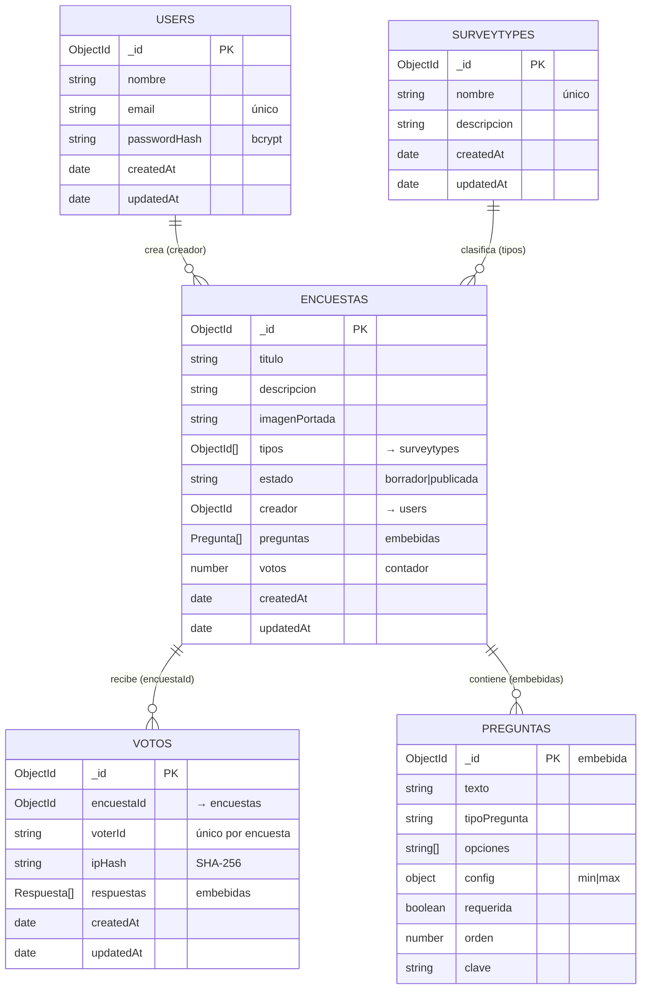

# Diagrama de la Base de Datos — PA Encuestas y Votaciones

Base de datos **`encuestas`** (MongoDB, vía Mongoose). Son **4 colecciones**; las
preguntas y las respuestas están **embebidas** dentro de sus documentos padre
(no son colecciones aparte).

## Diagrama entidad-relación

> La imagen equivalente, lista para pegar en el informe, está en
> [`docs/diagrama-base-de-datos.png`](diagrama-base-de-datos.png).

## Colecciones y campos

### `users` — usuarios
| Campo | Tipo | Notas |
| --- | --- | --- |
| `_id` | ObjectId | clave primaria |
| `nombre` | string | |
| `email` | string | único, en minúsculas |
| `passwordHash` | string | cifrado con bcrypt |
| `createdAt` / `updatedAt` | date | timestamps |

### `surveytypes` — tipos de encuesta
| Campo | Tipo | Notas |
| --- | --- | --- |
| `_id` | ObjectId | clave primaria |
| `nombre` | string | único |
| `descripcion` | string | |
| `createdAt` / `updatedAt` | date | timestamps |

### `encuestas` — encuestas
| Campo | Tipo | Notas |
| --- | --- | --- |
| `_id` | ObjectId | clave primaria |
| `titulo` / `descripcion` / `imagenPortada` | string | metadatos |
| `tipos` | ObjectId[] | referencia a `surveytypes` |
| `estado` | string | `borrador` \| `publicada` |
| `creador` | ObjectId | referencia a `users` |
| `preguntas` | Pregunta[] | **embebidas** (ver abajo) |
| `votos` | number | contador de votos |
| `createdAt` / `updatedAt` | date | timestamps |

### `preguntas` (subdocumento embebido en `encuestas`)
| Campo | Tipo | Notas |
| --- | --- | --- |
| `_id` | ObjectId | id propio (referenciado por los votos) |
| `texto` | string | enunciado |
| `tipoPregunta` | string | `texto` \| `verdadero_falso` \| `checklist` \| `seleccion_multiple` \| `seleccion_unica` |
| `opciones` | string[] | opciones (vacío si no aplica) |
| `config` | object | `min` / `max` |
| `requerida` | boolean | |
| `orden` | number | posición en la encuesta |
| `clave` | string | nombre corto para exportar (CSV/ARFF) |

### `votos` — votos / respuestas
| Campo | Tipo | Notas |
| --- | --- | --- |
| `_id` | ObjectId | clave primaria |
| `encuestaId` | ObjectId | referencia a `encuestas` |
| `voterId` | string | cookie/votante; índice único `{encuestaId, voterId}` |
| `ipHash` | string | IP hasheada (SHA-256) |
| `respuestas` | Respuesta[] | **embebidas**: `{ preguntaId, valor }` |
| `createdAt` / `updatedAt` | date | timestamps |

## Relaciones

| Relación | Cardinalidad | Cómo se implementa |
| --- | --- | --- |
| `users` → `encuestas` | 1 : N | `encuestas.creador` referencia a `users._id` |
| `surveytypes` → `encuestas` | N : M | `encuestas.tipos[]` referencia a `surveytypes._id` |
| `encuestas` → `votos` | 1 : N | `votos.encuestaId` referencia a `encuestas._id` |
| `encuestas` → `preguntas` | 1 : N | **embebidas** en `encuestas.preguntas[]` |
| `votos` → `respuestas` | 1 : N | **embebidas** en `votos.respuestas[]` |
