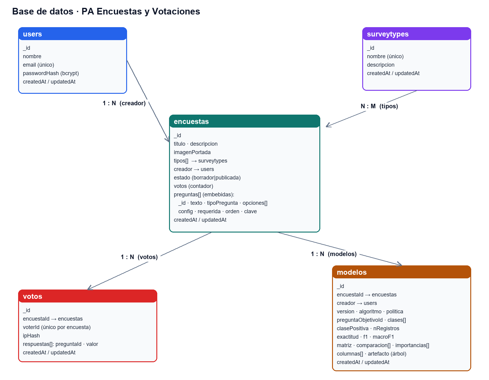

**BASE DE DATOS II**

**Entregado por:**

RONY ANDRES VALDELAMAR VERGARA

VICTOR ROCHA RAMOS

ANIBAL MEZA ANAYA

JAIR JOSÉ SÁNCHEZ PÉREZ

**UNIVERSIDAD FUNDACIÓN ACADÉMICA**

**TECNOLÓGICO COMFENALCO**

INGENIERÍA EN SISTEMAS SEMESTRE

14/10/2026

# **Resumen**

La Plataforma de **Encuestas y Votaciones** es una aplicación web construida con Next.js que permite crear, publicar y responder encuestas de uso múltiple: encuestas de satisfacción, de clima laboral, votaciones internas o cualquier otro tipo que se registre en el sistema. Un usuario registrado diseña la encuesta con distintos tipos de pregunta, la publica y comparte el enlace; cada participante puede votar una sola vez y el creador consulta los resultados y los exporta.

Además, la plataforma integra un **modelo predictivo que se entrena dentro de la propia aplicación**. Con los votos de una encuesta se entrena un clasificador binario (Sí / No), se muestran sus métricas, su matriz de confusión y su árbol de decisión, se simulan respuestas y se puede **reentrenar** cuando llegan votos nuevos, conservando el historial de versiones. La aplicación está desplegada en Vercel y guarda sus datos en MongoDB Atlas, en **cinco colecciones**.

# **1. Introducción**

Muchas organizaciones necesitan recoger la opinión de sus integrantes de forma ordenada, sin depender de formularios sueltos ni de conteos manuales. Este proyecto resuelve esa necesidad con una plataforma propia en la que las encuestas, las preguntas y los votos quedan en una sola base de datos, con control de duplicados y acceso restringido a los resultados.

El valor de la plataforma no está solo en recolectar respuestas, sino en **analizarlas y predecir comportamientos**. Por eso el sistema incorpora un motor de minería de datos que entrena un modelo con los votos de una encuesta, lo evalúa con validación cruzada, lo visualiza y permite reentrenarlo con datos nuevos.

El documento describe cómo está construida la plataforma: sus tecnologías, sus componentes, el modelo de la base de datos, el modelo predictivo, la exportación de datos, el despliegue en producción y el script de seed usado para cargar datos de prueba.

# **2. Tecnologías**

| Capa | Tecnología | Uso en el proyecto |
| :---- | :---- | :---- |
| Framework | Next.js 16 (App Router, Turbopack) | Interfaz y API en un mismo proyecto |
| Interfaz | React 19, Tailwind CSS, shadcn/ui | Pantallas y componentes visuales |
| Autenticación | Auth.js v5 | Registro e inicio de sesión de usuarios |
| Base de datos | MongoDB con Mongoose | Modelos y consultas de las 5 colecciones |
| Modelo predictivo | TypeScript puro: árbol J48, Naive Bayes, k-NN y bosque aleatorio | Entrenamiento, validación cruzada y predicción dentro de la app |
| Producción | Vercel + MongoDB Atlas | Hosting de la aplicación y de la base de datos |
| Desarrollo local | mongodb-memory-server | Base de datos en memoria para pruebas |

El motor del modelo se escribió en TypeScript puro, sin dependencias nativas ni servicios externos, para que pueda ejecutarse en las funciones de Vercel junto con el resto de la aplicación.

# **3. Estructura y componentes**

La aplicación se organiza en cinco partes que trabajan juntas dentro del mismo proyecto de Next.js:

* Interfaz de usuario: pantallas para registrarse, iniciar sesión, crear y editar encuestas, publicarlas, votar, ver resultados, exportarlos y entrenar el modelo predictivo.

* API: rutas de Next.js que atienden el CRUD de encuestas, el registro de votos, la autenticación, el entrenamiento y la predicción del modelo, y la exportación de datos.

* Autenticación: Auth.js gestiona las sesiones; las contraseñas se guardan cifradas en el campo `passwordHash`, nunca en texto plano.

* Capa de datos: modelos de Mongoose que definen la estructura de las cinco colecciones y validan los datos antes de guardarlos.

* Motor del modelo predictivo: módulo independiente que construye la matriz de datos, entrena los algoritmos, calcula las métricas y genera las predicciones.

## **Funcionalidades principales**

* Encuestas de uso múltiple, clasificadas por uno o varios tipos (por ejemplo, Satisfacción).

* Cinco tipos de pregunta: texto, verdadero/falso, checklist, selección múltiple y selección única.

* Configuración por pregunta: si es obligatoria y su orden. El esquema reserva además límites mínimo y máximo de selección, aunque la interfaz todavía no los expone.

* Estados de la encuesta: borrador mientras se edita y publicada cuando ya recibe votos.

* Un voto por participante: cada voto guarda un identificador del votante y un hash de su IP, y la base de datos impide dos votos del mismo votante en la misma encuesta.

* Resultados de la votación para el creador y para quien ya participó; los datos agregados del análisis de factores son del creador.

* Exportación de resultados en CSV y ARFF, disponible solo para el creador de la encuesta.

* **Modelo predictivo binario** (Sí / No) entrenado con los votos de una encuesta, sin salir de la aplicación.

* **Comparación de cuatro algoritmos** con validación cruzada estratificada y métricas fuera de muestra.

* **Visualización del modelo**: árbol de decisión navegable, reglas, matriz de confusión, métricas por clase e importancia de las variables.

* **Simulador de respuestas y ejemplos reales** del conjunto de datos, con la predicción del modelo frente a la respuesta real.

* **Reentrenamiento versionado**: cada entrenamiento crea una versión nueva y conserva el historial con sus métricas.

* **Análisis de todos los factores** de la encuesta: distribución, promedios, porcentaje de la clase positiva por grupo y poder predictivo de cada pregunta.

# **4. Modelo de base de datos**

La base de datos usa MongoDB con **cinco colecciones**: `users`, `surveytypes`, `encuestas`, `votos` y `modelos`. Las preguntas, sus opciones, las respuestas y los artefactos del modelo se guardan como documentos embebidos; los tipos se guardan como referencias.

| Colección | Campos principales | Relación |
| :---- | :---- | :---- |
| users | _id, nombre, email (único), passwordHash, createdAt, updatedAt | Un usuario crea muchas encuestas y entrena modelos |
| surveytypes | _id, nombre (único), descripcion, createdAt, updatedAt | Un tipo clasifica muchas encuestas |
| encuestas | _id, titulo, descripcion, imagenPortada, estado, creador, tipos, votos, createdAt, updatedAt | Pertenece a un usuario; recibe votos y modelos |
| votos | _id, encuestaId, voterId, ipHash, respuestas, createdAt, updatedAt | Pertenece a una encuesta; índice único en (encuestaId, voterId) |
| modelos | _id, encuestaId, creador, version, algoritmo, politica, preguntaObjetivoId, clases, clasePositiva, nRegistros, exactitud, f1, macroF1, matriz, comparacion, columnas, importancias, reglas, artefacto, createdAt, updatedAt | Una encuesta acumula versiones; las crea su creador |

Documentos embebidos:

| Documento | Se guarda en | Campos |
| :---- | :---- | :---- |
| tipos | encuestas | arreglo de referencias (ObjectId) a surveytypes |
| preguntas | encuestas | _id, texto, tipoPregunta, opciones, config (min y max), requerida, orden, clave |
| opciones | preguntas | arreglo de textos; cada opción es una cadena, no un documento aparte |
| respuestas | votos | preguntaId, valor (tipo mixto según la pregunta) |
| artefactos del modelo | modelos | matriz, comparacion, columnas, importancias, reglas y artefacto serializado |

Las preguntas y sus opciones se embeben en la encuesta porque siempre se leen juntas con ella: una sola consulta trae la encuesta completa lista para mostrarse. Las respuestas se embeben en cada voto por la misma razón. Los votos, en cambio, van en su propia colección porque crecen sin límite y necesitan el índice único que evita votos duplicados.

La colección `modelos` también va aparte porque cada entrenamiento produce un documento nuevo (con su versión, sus métricas y su artefacto serializado), los artefactos pueden ser grandes y el historial se consulta de forma independiente a la encuesta. Así se puede reentrenar sin perder las versiones anteriores.

Índices principales:

| Colección | Índice | Para qué |
| :---- | :---- | :---- |
| users | email (único) | Evitar cuentas duplicadas |
| surveytypes | nombre (único) | Evitar tipos repetidos |
| votos | (encuestaId, voterId) único | Impedir dos votos del mismo participante |
| votos | encuestaId | Consultar los votos de una encuesta |
| encuestas | texto sobre titulo y descripcion | Búsqueda por texto |
| modelos | (encuestaId, version) y (encuestaId, createdAt) | Historial ordenado por versión y fecha |

Valores posibles: `estado` puede ser `borrador` o `publicada`; `tipoPregunta` puede ser `texto`, `verdadero_falso`, `checklist`, `seleccion_multiple` o `seleccion_unica`; `algoritmo` puede ser `arbol`, `naive_bayes`, `knn` o `bosque`; `politica` puede ser `excluir` o `mapear_no`.

# **5. Modelo predictivo**

Esta es la funcionalidad diferencial del proyecto: el modelo no vive solo en una herramienta externa como Weka, sino que se entrena, se evalúa, se visualiza y se reentrena dentro de la plataforma.

## **5.1 Variable objetivo binaria**

El modelo siempre predice **dos clases**. La variable objetivo se elige entre las preguntas de la encuesta que producen dos resultados:

* Una pregunta de verdadero/falso (por ejemplo, si recomendaría la empresa).

* Una pregunta de selección única con exactamente dos opciones (por ejemplo, Sí y No).

* Una pregunta de selección única con tres opciones cuando una es una abstención del tipo «No sé». En ese caso se decide si esos votos se excluyen del entrenamiento o se cuentan como la clase negativa.

En la encuesta de clima laboral del seed la variable objetivo es «¿Piensas seguir en la empresa el próximo año?», con dos opciones: Sí y No. El conjunto quedó con 218 respuestas Sí y 202 respuestas No, de modo que el azar de referencia es el 50 por ciento.

## **5.2 Preparación de los datos**

1. Se toman los votos de la encuesta y se descartan los que no respondieron la pregunta objetivo.

2. Se construye una matriz tabular: una fila por votante y una columna por pregunta.

3. Las escalas de 1 a 5 se convierten en variables numéricas y las respuestas de verdadero/falso en variables nominales.

4. Las preguntas de selección múltiple y checklist se convierten en una columna por opción (marcada o sin marcar).

5. Las preguntas de texto libre no se usan como variables del modelo, porque no aportan categorías comparables.

6. Los valores faltantes se imputan con la mediana en las variables numéricas y con una categoría «sin respuesta» en las nominales.

7. La pregunta objetivo se excluye de las variables predictoras para no filtrar la respuesta que se quiere predecir.

## **5.3 Algoritmos y validación**

El sistema compara cuatro algoritmos con las mismas particiones de datos:

* **Árbol de decisión (J48)**: divide los datos con el criterio de razón de ganancia y poda las ramas que no aportan. Es el modelo principal porque produce reglas legibles.

* **Naive Bayes**: modelo probabilístico que combina la probabilidad previa de cada clase con la de cada respuesta.

* **k-NN**: clasifica cada caso según los cinco votantes más parecidos del conjunto de entrenamiento.

* **Bosque aleatorio**: combina 25 árboles entrenados con muestras y subconjuntos de variables distintos.

La evaluación usa **validación cruzada estratificada de 5 particiones**: los datos se dividen en cinco grupos que conservan la proporción de clases y cada grupo se predice con un modelo entrenado en los otros cuatro. Así las métricas se calculan con datos que el modelo no vio durante el entrenamiento. La semilla es fija (20261012), por lo que los resultados son reproducibles.

Las métricas calculadas son exactitud, precisión, exhaustividad, F1 y macro-F1, además de la matriz de confusión.

## **5.4 Resultados obtenidos**

Con los 420 votos del seed, los cuatro algoritmos superan con claridad el 50 por ciento del azar binario:

| Algoritmo | Exactitud | F1 | Macro-F1 |
| :---- | :---- | :---- | :---- |
| Naive Bayes | 71 % | 72 % | 71 % |
| Bosque aleatorio | 68 % | 70 % | 67 % |
| Árbol de decisión (J48) | 66 % | 70 % | 66 % |
| k-NN (k = 5) | 63 % | 65 % | 63 % |

Matriz de confusión del árbol de decisión, calculada con predicciones fuera de muestra:

| Caso | Predice Sí | Predice No |
| :---- | :---- | :---- |
| Real Sí | 165 (verdaderos positivos) | 53 (falsos negativos) |
| Real No | 88 (falsos positivos) | 114 (verdaderos negativos) |

Las variables más influyentes que aprende el modelo son la comunicación (cerca del 41 por ciento de la importancia), la carga laboral (cerca del 28 por ciento), el reconocimiento (cerca del 20 por ciento) y el salario (cerca del 8 por ciento), lo que coincide con el análisis exploratorio de los datos.

El árbol se mantiene como modelo principal por su interpretabilidad, pero la aplicación permite cambiar de algoritmo y comparar los resultados en vivo.

## **5.5 Visualización en la aplicación**

La página del modelo, disponible en la ruta `/encuestas/[id]/modelo`, presenta cuatro pestañas:

* **Entrenamiento**: elección de la variable objetivo, del algoritmo y de la política para los votos «No sé»; botón para entrenar o reentrenar; comparación de los cuatro algoritmos e historial de versiones.

* **Modelo**: ficha de la versión, métricas, matriz de confusión, métricas por clase, árbol de decisión navegable, reglas en formato «si … entonces …» e importancia de las variables.

* **Predicción**: simulador en el que se responden las preguntas y el modelo devuelve la clase, la probabilidad y el camino de decisión; además, casos reales del conjunto de datos con la predicción del modelo y la respuesta verdadera.

* **Factores**: análisis de todas las preguntas de la encuesta, no solo de la variable objetivo.

## **5.6 Reentrenamiento y versiones**

Cada vez que se pulsa «Reentrenar con los votos actuales» se crea un documento nuevo en la colección `modelos`, con una versión incremental. Las versiones anteriores se conservan con sus métricas, de modo que se puede comparar el efecto de recolectar más respuestas sin perder el modelo previo. Las predicciones siempre usan la versión más reciente o la que se indique.

## **5.7 API y permisos**

| Método y ruta | Función |
| :---- | :---- |
| POST /api/surveys/[id]/modelo | Entrena un modelo y guarda una versión nueva |
| GET /api/surveys/[id]/modelo | Devuelve el historial de versiones |
| POST /api/surveys/[id]/modelo/predecir | Predice un caso con la versión indicada |
| DELETE /api/surveys/[id]/modelo?modeloId=… | Elimina una versión del historial |

Todas las rutas del modelo, igual que la exportación, verifican la sesión y que el usuario sea el creador de la encuesta; en caso contrario responden con el código 403. La página también exige ser el creador.

## **5.8 Análisis de todos los factores**

La pestaña **Factores** complementa al modelo: muestra, para cada pregunta, cuántos votos la respondieron, su distribución, el promedio cuando es una escala, el porcentaje de la clase positiva en cada grupo y un ranking de poder predictivo calculado con la ganancia de información. Así los resultados no se limitan a la decisión de quedarse o no, sino que cubren todos los puntos de la encuesta.

# **6. Exportación de datos**

## **6.1 CSV y XLSX**

La exportación en CSV entrega una fila por encuestado y una columna por pregunta, con la fecha del voto en la primera columna. El archivo se genera en UTF-8 con marca de orden de bytes (BOM), de modo que Excel muestre correctamente los acentos, y conserva las etiquetas originales como «Sí», «Tecnología» o «Híbrida». El archivo XLSX incluye una hoja «Datos» y una hoja «Diccionario» que explica cada columna.

## **6.2 ARFF para Weka**

El archivo ARFF se genera con la clase como último atributo, lista para abrirse en Weka. Como Weka puede interpretar mal los acentos según la configuración regional, las etiquetas del ARFF van **sin acentos** («Si», «No», «Tecnologia», «Hibrida»), mientras que el texto original acentuado y la equivalencia de cada etiqueta quedan documentados en comentarios que empiezan por el signo de porcentaje. Weka ignora esos comentarios, pero el lector puede consultarlos dentro del mismo archivo.

## **6.3 Entregables**

A partir de los datos del seed se generan tres archivos en la carpeta `entregables`: el CSV y el XLSX para el tablero de control y el ARFF para Weka. La carpeta `export-atlas` contiene los documentos JSON listos para pegar en Atlas. El script `generar-entregables.py` regenera todos los archivos en un solo paso.

# **7. Despliegue en producción**

* Aplicación: el proyecto de Next.js está desplegado en Vercel, que sirve las páginas y ejecuta las rutas de la API.

* Base de datos: la información vive en un clúster de MongoDB Atlas, al que la aplicación se conecta mediante una cadena de conexión guardada como variable de entorno en Vercel.

* Configuración: las credenciales (cadena de conexión de MongoDB y secreto de Auth.js) no están en el código; se definen en las variables de entorno de cada entorno.

* Modelo predictivo: el entrenamiento se ejecuta en la misma función de Vercel, sin servicios externos. La colección `modelos` se crea en el primer entrenamiento y crece con cada versión.

* Desarrollo local: si no se configura Atlas, la aplicación puede usar mongodb-memory-server, una base de datos en memoria que se crea al iniciar.

# **8. Carga de datos de prueba (seed)**

Para tener datos con los que probar la plataforma se escribió el script `seed-encuesta.mjs`, que llena la base de datos con una encuesta de clima laboral completa:

* Crea una encuesta de 11 preguntas: área, antigüedad, edad, modalidad, comunicación, reconocimiento, carga laboral, equipo, salario, si recomendaría la empresa y si piensa seguir en ella.

* La intención de seguir es una variable **binaria**: Sí o No, sin la opción «No sé».

* Genera 420 votos, cada uno con sus 11 respuestas, respetando el tipo de cada pregunta (opciones, escalas de 1 a 5 y verdadero/falso).

* La distribución resultante es de 218 respuestas Sí y 202 respuestas No.

* Usa una semilla fija, de modo que cada ejecución produce exactamente los mismos datos.

* Incorpora correlaciones intencionales entre las escalas de satisfacción y la intención de permanencia, para que el modelo y Weka encuentren patrones reales.

Opciones del script:

| Opción | Efecto |
| :---- | :---- |
| --email=correo | Deja la encuesta a nombre de un usuario real de la app |
| --exportar | Genera los JSON de export-atlas sin conectarse a MongoDB |
| --limpiar | Informa cuántas encuestas y votos se borrarían; con --confirmar borra y guarda respaldo |
| --borrar | Elimina solo los datos creados por el propio seed |

Además, el script `migrar-binario.mjs` convierte una encuesta antigua que todavía tenga la opción «No sé» en una encuesta binaria: por defecto solo simula el cambio y, con la opción de confirmación, reetiqueta esos votos como la clase negativa o los elimina, guardando un respaldo antes de escribir.

El proyecto incluye un **segundo seed** (`seed-satisfaccion.mjs`) con otra encuesta de 12 preguntas y **520 votos** sobre satisfacción y experiencia de compra en línea: frecuencia, dispositivo, categoría, edad, precio, envío, producto, atención, devoluciones y uso de la app, con una pregunta de recomendación y la intención de volver a comprar como variable objetivo binaria. Usa el mismo criterio reproducible, admite `--total` para cambiar el número de votos y se ejecuta con `npm run seed:satisfaccion`; sus datos conviven con los del seed de clima laboral.

# **9. Verificación y pruebas**

| Comprobación | Resultado |
| :---- | :---- |
| Seed: votos esperados y exportados | 420 de 420 |
| Seed: respuestas por voto | 11 de 11 |
| Seed: valores faltantes y votantes duplicados | 0 y 0 |
| Modelo: entrenamiento y reentrenamiento | Versiones creadas correctamente |
| Modelo: métricas fuera de muestra | Árbol 66 %, F1 70 %, macro-F1 66 % |
| Modelo: predicción de un perfil favorable y uno desfavorable | Sí con 93 % y No con 3 % |
| Segunda encuesta (satisfacción) | 520 votos; árbol 81 %, F1 84 %, macro-F1 81 % |
| Exportación ARFF | Clase binaria sin acentos y diccionario incluido |
| Exportación CSV | BOM UTF-8 y acentos conservados |
| Calidad del código | ESLint, TypeScript y build de producción sin errores |

Los scripts `verificar-seed.mjs` y `verificar-modelo.mjs` automatizan estas comprobaciones. El segundo inicia sesión, entrena, reentrena, predice y revisa la página del modelo contra una instancia en marcha.

# **10. Limitaciones y trabajo futuro**

* El modelo solo puede entrenarse con encuestas que tengan una pregunta binaria y al menos 20 votos con las dos clases presentes.

* Solo el creador de la encuesta puede entrenar, predecir y exportar; el resto de usuarios recibe un error de permisos.

* En volúmenes muy grandes de votos, el algoritmo k-NN guarda el conjunto de entrenamiento completo en el documento del modelo y podría acercarse al límite de tamaño de MongoDB; para esos casos conviene usar el árbol o el bosque.

* Las imágenes de portada subidas se guardan en el sistema de archivos efímero de Vercel y se pierden en cada despliegue; en producción conviene usar una URL.

* El texto libre no participa como variable del modelo, porque requiere un tratamiento de lenguaje natural que queda fuera del alcance del curso.

* Como trabajo futuro se propone incorporar datos reales, ajustar hiperparámetros y balancear las clases, y llevar el tablero de control a una página interna de la aplicación.

# **11. Referencias**

* Chapman, P. et al. (2000). CRISP-DM 1.0: Step-by-step data mining guide.

* Witten, I. H., Frank, E., Hall, M. A. y Pal, C. J. (2016). Data Mining: Practical Machine Learning Tools and Techniques. Morgan Kaufmann.

* Han, J., Kamber, M. y Pei, J. (2011). Data Mining: Concepts and Techniques.

* Documentación oficial de Next.js, MongoDB, Mongoose, Auth.js y Weka.
