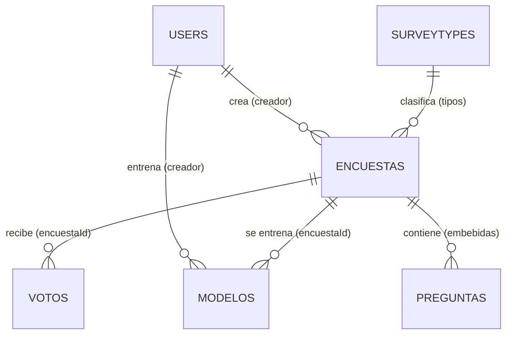

# Informe Metodológico — Proyecto de Aula

## Plataforma de Encuestas y Votaciones para la Predicción del Clima Laboral

**Integrantes del grupo:**

1. Rony Valdelamar
2. Anibal Meza
3. Victor Rocha
4. Jair Perez

---

## Resumen

Este proyecto desarrolla una plataforma web de encuestas y votaciones que,
además de recolectar opiniones, **entrena un modelo predictivo dentro de la
propia aplicación**, **visualiza el modelo** (árbol, reglas, métricas y
ejemplos reales) y **permite reentrenarlo** con los votos nuevos sin salir del
sistema. Para ello se sembró una base de datos MongoDB con una encuesta de clima
laboral de **420 respuestas y 11 preguntas**, con correlaciones intencionales
entre las variables de satisfacción y la intención de permanencia del
colaborador. La variable objetivo es **binaria** (`Sí` / `No`).

Los datos se exportan a formato tabular (CSV/XLSX) para el tablero y a formato
ARFF para entrenar en Weka. La metodología seguida es **CRISP-DM**,
complementada con un desarrollo iterativo de software.

---

## 1. Introducción

La gestión del talento humano se apoya cada vez más en datos: conocer qué
factores (comunicación, reconocimiento, carga laboral, ambiente, salario)
influyen en la intención de un empleado de continuar en la organización permite
tomar decisiones de retención anticipadas. Una plataforma de encuestas y
votaciones es el instrumento natural para recolectar esa información; sin
embargo, el valor no está en almacenar respuestas sino en **analizarlas** y
**predecir** comportamientos.

Este proyecto integra tres componentes:

1. **Recolección:** una aplicación web para crear encuestas, publicarlas y
   recolectar votos (un voto por dispositivo/IP).
2. **Visualización:** un tablero de control (dashboard) y un análisis de todos
   los factores de la encuesta.
3. **Minería de datos:** un modelo predictivo **implementado en la plataforma**
   que se entrena, se evalúa y se reentrena desde la interfaz, y que además
   puede exportarse para su análisis en Weka.

---

## 2. Planteamiento del problema

Las organizaciones suelen aplicar encuestas de clima laboral pero rara vez
pasan de la descripción agregada (promedios y gráficas). Se desconoce **qué
combinación de factores predice mejor la rotación o la permanencia**, lo que
limita la toma de decisiones. Se plantea entonces la siguiente pregunta de
investigación:

> **¿Qué variables de clima laboral permiten predecir la intención de un
> colaborador de permanecer en la empresa el próximo año?**

### Hipótesis

- **H1:** Las variables de satisfacción (comunicación, reconocimiento, carga,
  ambiente y salario) se asocian positivamente con la intención de permanencia.
- **H2:** La antigüedad modera dicha relación (los colaboradores con más de 5
  años muestran mayor intención de permanencia).
- **H3:** Un clasificador supervisado puede predecir la permanencia con una
  exactitud superior al azar (**50 % con dos clases balanceadas**).

---

## 3. Justificación

El proyecto es relevante en tres planos:

- **Académico:** aplica el ciclo completo de la minería de datos (CRISP-DM)
  sobre un caso realista, desde la preparación de datos hasta el despliegue del
  modelo dentro de un sistema real.
- **Práctico:** entrega artefactos reutilizables (base poblada, archivos de
  datos, modelo entrenado y con versiones) que cualquier analista puede abrir en
  Excel, Power BI o Weka.
- **Tecnológico:** valida una arquitectura moderna (Next.js + MongoDB) como
  fuente de datos y como motor de analítica: el modelo entrena y predice en el
  servidor de la aplicación, sin necesidad de un servicio externo.

---

## 4. Objetivos

### Objetivo general

Desarrollar una plataforma de encuestas y votaciones que sirva de fuente de
datos para construir un tablero de control y un modelo predictivo **binario** de
la intención de permanencia laboral, entrenado y visualizado dentro de la propia
plataforma.

### Objetivos específicos

1. Diseñar e implementar el modelo de datos (5 colecciones) de la plataforma.
2. Generar y poblar una base de datos con 420 respuestas simuladas de clima
   laboral con **dos resultados posibles** (`Sí` / `No`).
3. Exportar los datos a formatos tabulares (CSV/XLSX) para el tablero de
   control y a ARFF para Weka, con un tratamiento explícito de los acentos.
4. **Implementar el entrenamiento del modelo dentro de la aplicación**, con
   comparación de algoritmos y validación cruzada.
5. **Visualizar el modelo entrenado**: árbol de decisión, reglas, matriz de
   confusión, importancia de variables y ejemplos reales del conjunto de datos.
6. **Permitir el reentrenamiento con datos nuevos**, conservando el historial de
   versiones y generando nuevas predicciones.
7. Analizar las distribuciones y correlaciones de todas las variables (EDA) y
   construir un tablero de control con los indicadores clave.

---

## 5. Alcance

- **Incluye:** creación y publicación de encuestas, votación con control de
  duplicados, exportación de resultados (solo para el creador), análisis de
  todos los factores, **modelo predictivo binario entrenado, visualizado y
  reentrenado desde la app**, base de datos poblada y exportación a Weka.
- **No incluye:** despliegue con datos reales de una empresa, analítica en
  tiempo real, ni técnicas de aprendizaje profundo.

---

## 6. Marco conceptual

- **Encuesta / votación:** instrumento de recolección de opiniones con preguntas
  de tipo selección única, selección múltiple, checklist, verdadero/falso y
  texto libre.
- **Clasificación binaria:** predicción de una variable con dos valores
  (aquí `Sí` / `No` sobre la intención de permanencia).
- **Minería de datos:** proceso de descubrir patrones en grandes conjuntos de
  datos mediante métodos estadísticos y de aprendizaje automático.
- **CRISP-DM:** metodología estándar en seis fases — comprensión del negocio,
  comprensión de los datos, preparación, modelado, evaluación y despliegue.
- **Validación cruzada estratificada:** partición de los datos en *k* pliegues
  conservando la proporción de clases; cada pliegue se predice con un modelo
  entrenado en el resto, de modo que las métricas se calculan fuera de muestra.
- **Árbol de decisión:** modelo interpretable que divide los datos con reglas
  del tipo *si comunicación ≥ 4 y carga ≥ 4, entonces tiende a `Sí`*.
- **Naive Bayes, k-NN y bosque aleatorio:** clasificadores de comparación.
- **Tablero de control (dashboard):** representación visual de indicadores clave
  para apoyar decisiones.

---

## 7. Metodología

Se adopta **CRISP-DM** para el componente de datos y un **desarrollo iterativo
(incremental)** para la plataforma web. Las fases se describen a continuación.

### Fase 0 — Desarrollo de la plataforma (software)

| Actividad | Descripción | Herramienta |
| --- | --- | --- |
| Diseño del modelo de datos | 5 colecciones: `users`, `surveytypes`, `encuestas`, `votos`, `modelos` | MongoDB / Mongoose |
| Implementación de la API | CRUD de encuestas, votación, autenticación, entrenamiento y predicción | Next.js 16, Auth.js v5 |
| Motor de minería de datos | Árbol J48, Naive Bayes, k-NN y bosque aleatorio, con validación cruzada | TypeScript (sin dependencias nativas) |
| Interfaz de usuario | Crear, publicar, votar, resultados, análisis de factores y modelo | React 19, Tailwind, shadcn/ui |
| Persistencia | Base local en memoria o MongoDB Atlas | mongodb-memory-server / Atlas |

### Fase 1 — Comprensión del negocio

Se define el objetivo de negocio: **identificar los factores que predicen la
intención de permanencia**. La variable objetivo es `sigue` (*¿Piensas seguir en
la empresa el próximo año?*), con **dos valores: `Sí` y `No`**. Se eliminó la
opción «No sé» para que el modelo sea una clasificación binaria con una línea
base clara (50 %).

### Fase 2 — Comprensión de los datos

Se diseñó una encuesta de **11 preguntas** (Tabla 1). Los datos se generaron de
forma reproducible mediante un script con semilla fija (`seed-encuesta.mjs`),
lo que garantiza que cualquier ejecución produce el mismo conjunto.

**Tabla 1. Variables del conjunto de datos**

| Variable | Tipo | Rol | Valores |
| --- | --- | --- | --- |
| `area` | nominal | predictor | Administrativa, Operativa, Comercial, Tecnología, Talento humano |
| `antiguedad` | nominal | predictor | Menos de 1 año, 1 a 3 años, 3 a 5 años, Más de 5 años |
| `edad` | nominal | predictor | 18 a 25, 26 a 35, 36 a 45, 46 o más |
| `modalidad` | nominal | predictor | Presencial, Híbrida, Remota |
| `comunicacion` | numérica 1–5 | predictor | 1 (nada clara) … 5 (muy clara) |
| `reconocimiento` | numérica 1–5 | predictor | 1 (nunca) … 5 (siempre) |
| `carga` | numérica 1–5 | predictor | 1 (insostenible) … 5 (muy sostenible) |
| `equipo` | numérica 1–5 | predictor | 1 (malo) … 5 (excelente) |
| `salario` | numérica 1–5 | predictor | 1 (nada) … 5 (totalmente) |
| `recomendaria` | nominal (true/false) | predictor | true, false |
| `sigue` | nominal | **clase (2 valores)** | Sí, No |

### Fase 3 — Preparación de los datos

1. **Limpieza:** se verificó que no hubiera valores faltantes ni duplicados
   (verificación automática: 420/420 votos, 11/11 respuestas, 0 faltantes,
   0 `voterId` duplicados).
2. **Aplanado:** los votos se guardan anidados (un arreglo `respuestas` por
   voto); se transformaron a formato **tabular** (una fila por encuestado, una
   columna por pregunta).
3. **Tipado:** las escalas 1–5 se convirtieron a valores numéricos; los valores
   booleanos a `true`/`false`; el resto quedó como nominal.
4. **Variable objetivo:** solo se consideran dos clases. Si una encuesta antigua
   todavía tiene la opción «No sé», la app permite **excluir** esos votos o
   **contarlos como la clase negativa** antes de entrenar.
5. **Exportación:** se generaron `CSV` y `XLSX` para el tablero y `ARFF` para
   Weka. En el ARFF la clase (`sigue`) queda como último atributo y **las
   etiquetas van sin acentos** (`Si`, `No`, `Tecnologia`, `Hibrida`) para que
   Weka las lea en cualquier configuración; el texto original acentuado queda
   documentado en comentarios `%` dentro del propio archivo.

### Fase 4 — Modelado

- **Técnica:** clasificación supervisada binaria (2 clases).
- **Algoritmos implementados y comparados en la app:** árbol de decisión
  (J48, criterio de razón de ganancia), Naive Bayes (gaussiano/multinomial),
  k-NN (k = 5) y bosque aleatorio (25 árboles con bagging).
- **Validación:** validación cruzada estratificada de 5 particiones
  (`k = 5`, configurable hasta 10).
- **Métricas:** exactitud (*accuracy*), precisión, exhaustividad (*recall*),
  medida F1, macro-F1 y matriz de confusión, todas calculadas **fuera de
  muestra**.

El árbol de decisión se propone como modelo principal por su
**interpretabilidad** (produce reglas legibles), aunque la comparación muestra
que otros algoritmos pueden alcanzar mayor exactitud.

### Fase 5 — Evaluación

Se comparan los modelos con las métricas anteriores y se selecciona el de mejor
desempeño. La app muestra la comparación completa y permite elegir con qué
algoritmo entrenar; además permite validar que las reglas encontradas coincidan
con el análisis exploratorio.

### Fase 6 — Despliegue

- La plataforma se despliega en **Vercel** con la base de datos en
  **MongoDB Atlas**.
- El modelo se entrena y se sirve **desde la propia aplicación** (la página
  `/encuestas/[id]/modelo`), guardando cada versión en la colección `modelos`.
- El tablero se construye en **Excel / Power BI** a partir del CSV/XLSX
  exportado.
- El modelo también puede abrirse y compararse en **Weka** con el archivo ARFF.

---

## 8. Modelo de datos

La base de datos `encuestas` consta de **5 colecciones**:

- **users:** cuentas de la plataforma (nombre, email único, contraseña cifrada).
- **surveytypes:** tipos de encuesta (ej. Satisfacción).
- **encuestas:** título, descripción, estado, creador, tipos y **preguntas
  embebidas**.
- **votos:** respuestas de los votantes, con control de duplicados por
  `{encuestaId, voterId}`.
- **modelos:** una versión del modelo predictivo por entrenamiento (algoritmo,
  métricas, variables, reglas y artefacto serializado).

> Diagrama completo en [`docs/diagrama-base-de-datos.md`](diagrama-base-de-datos.md).

---

## 9. Análisis exploratorio de datos (EDA)

Sobre los 420 registros se calcularon distribuciones y promedios.

### 9.1 Distribución de la clase objetivo

| Valor | Frecuencia | Porcentaje |
| --- | --- | --- |
| Sí | 218 | 51.9 % |
| No | 202 | 48.1 % |

La clase está **prácticamente balanceada**, de modo que la línea base de
referencia es el **50 %** y las métricas no se ven dominadas por una clase
mayoritaria.

### 9.2 Distribución de variables demográficas

| Variable | Categoría | % |
| --- | --- | --- |
| area | Operativa / Administrativa / Comercial / Tecnología / Talento humano | 28.6 / 28.6 / 20.7 / 12.4 / 9.8 |
| antiguedad | 1 a 3 años / Menos de 1 año / 3 a 5 años / Más de 5 años | 33.3 / 28.6 / 21.2 / 16.9 |
| edad | 26 a 35 / 18 a 25 / 36 a 45 / 46 o más | 38.3 / 29.8 / 20.2 / 11.7 |
| modalidad | Presencial / Híbrida / Remota | 45.7 / 35.2 / 19.0 |

### 9.3 Promedio de las escalas de satisfacción (1–5)

| Variable | Promedio |
| --- | --- |
| equipo | 3.18 |
| reconocimiento | 3.07 |
| salario | 3.01 |
| comunicacion | 2.99 |
| carga | 2.84 |

La **carga laboral** es el factor peor valorado (2.84), lo que sugiere un foco
de intervención. El equipo es el mejor valorado (3.18).

### 9.4 Relación entre cada factor y la intención de permanencia

| Predictor | 4–5 → "Sí" | 1–2 → "Sí" |
| --- | --- | --- |
| comunicación | 73 % | 25 % |
| reconocimiento | 72 % | 26 % |
| carga | 76 % | 38 % |
| equipo | 68 % | 34 % |
| salario | 73 % | 29 % |

**Lectura:** existe una asociación fuerte y positiva entre los factores de
satisfacción y la intención de permanecer. Por ejemplo, quienes valoran bien la
comunicación (4–5) tienen 73 % de intención de "Sí", frente al 25 % de quienes la
valoran mal (1–2). Incluso en el factor con menor brecha (carga) la diferencia
es de 38 puntos porcentuales. Esto confirma las hipótesis **H1** y **H2** y da
soporte a la construcción del modelo.

### 9.5 Intención de permanencia por área

| Área | % "Sí" |
| --- | --- |
| Administrativa | 57 % |
| Comercial | 57 % |
| Operativa | 48 % |
| Tecnología | 48 % |
| Talento humano | 41 % |

Estas diferencias se exploran en la propia app, en la pestaña **Factores**,
junto con el **poder predictivo** (ganancia de información normalizada) de cada
pregunta.

---

## 10. Modelo predictivo implementado en la plataforma

Esta es la aportación central del proyecto: el modelo **no vive solo en Weka**,
sino que se entrena, se evalúa, se visualiza y se reentrena dentro de la app.

### 10.1 Acceso y alcance

- Página: **`/encuestas/[id]/modelo`**, accesible solo para el **creador** de la
  encuesta (la API responde `403` a cualquier otro usuario).
- API:
  - `POST /api/surveys/[id]/modelo` — entrena y guarda una versión nueva.
  - `GET /api/surveys/[id]/modelo` — historial de versiones.
  - `POST /api/surveys/[id]/modelo/predecir` — predice un caso concreto.
  - `DELETE /api/surveys/[id]/modelo?modeloId=…` — elimina una versión.

### 10.2 Entrenamiento

El entrenador (`src/lib/modelo/`) recibe las preguntas y los votos, construye la
matriz tabular, binariza la variable objetivo y ejecuta:

1. **Validación cruzada estratificada** (5 particiones por defecto).
2. **Comparación de los 4 algoritmos** con las mismas particiones.
3. **Entrenamiento final** con el 100 % de los datos y el algoritmo elegido.
4. **Persistencia** del artefacto, las métricas, las variables y las reglas en
   la colección `modelos`, con versión incremental.

La variable objetivo se elige en la interfaz entre las preguntas que producen
dos clases (selección única con dos opciones, o verdadero/falso). Si la
pregunta aún conserva una opción «No sé», se decide si **excluir** esos votos o
**contarlos como la clase negativa**.

### 10.3 Resultados obtenidos

Con los 420 votos del seed y la semilla fija `20261012` (resultados
reproducibles):

| Algoritmo | Exactitud | F1 (Sí) | Macro-F1 |
| --- | --- | --- | --- |
| Naive Bayes | 71 % | 72 % | 71 % |
| Bosque aleatorio | 68 % | 70 % | 67 % |
| **Árbol de decisión (J48)** | **66 %** | **70 %** | **66 %** |
| k-NN (k = 5) | 63 % | 65 % | 63 % |

Matriz de confusión del árbol de decisión (predicciones fuera de muestra):

|  | Predice «Sí» | Predice «No» |
| --- | --- | --- |
| **Real «Sí»** | 165 (VP) | 53 (FN) |
| **Real «No»** | 88 (FP) | 114 (VN) |

Los cuatro algoritmos **superan con claridad el 50 % del azar binario**
(H3 confirmada). El árbol se mantiene como modelo principal por su
interpretabilidad, y la app permite cambiar de algoritmo y comparar en vivo. El
modelo aprende que las variables más influyentes son la **comunicación**
(≈41 % de la importancia), la **carga laboral** (≈28 %), el **reconocimiento**
(≈20 %) y el **salario** (≈8,5 %), lo que coincide con el análisis exploratorio.
La pregunta de recomendación aporta poco cuando el objetivo es la permanencia.

### 10.4 Visualización del modelo

La página muestra, para la versión seleccionada:

- **Ficha del modelo**: versión, algoritmo, fecha, registros usados y excluidos.
- **Métricas**: exactitud, F1 de la clase positiva, macro-F1, matriz de
  confusión y métricas por clase.
- **Árbol de decisión** navegable (condiciones, tamaño de cada rama y
  probabilidad de la clase positiva en cada hoja).
- **Reglas principales** en formato `SI … Y … ENTONCES …`, con cobertura y
  confianza.
- **Importancia de las variables**.
- **Ejemplos reales**: votos del conjunto de datos con la predicción del modelo
  y la respuesta real (aciertos y errores), que pueden cargarse en el
  simulador.
- **Simulador**: se responden las preguntas y el modelo devuelve la clase, la
  probabilidad y el camino de decisión que siguió.
- **Análisis de factores**: distribución de cada pregunta, promedio de las
  escalas, porcentaje de «Sí» por grupo y poder predictivo.

### 10.5 Reentrenamiento con datos nuevos

Cada vez que se pulsa **«Reentrenar con los votos actuales»** se crea una
**versión nueva**; las anteriores se conservan en el historial con sus métricas.
Así se puede comparar el efecto de recolectar más respuestas sin perder el
modelo previo. Las predicciones siempre usan la versión seleccionada.

---

## 11. Tablero de control (dashboard)

A partir de `entregables/datos-clima-laboral.xlsx` (hoja "Datos" + "Diccionario")
se proponen los siguientes indicadores:

| Indicador | Visualización sugerida | Fuente (columnas) |
| --- | --- | --- |
| Distribución de la intención de permanencia | Dona / barras | `sigue` |
| Satisfacción promedio por factor | Barras (1–5) | `comunicacion`, `reconocimiento`, `carga`, `equipo`, `salario` |
| Composición por área y modalidad | Barras apiladas | `area`, `modalidad` |
| Promotores vs detractores | Barras | `recomendaria` |
| Evolución temporal de respuestas | Línea | `fecha` |
| % de "Sí" por área | Tabla / barras | `area` × `sigue` |
| Exactitud y matriz de confusión del modelo | Tarjetas + tabla | colección `modelos` |

---

## 12. Resultados esperados

1. Un **modelo clasificador binario** con exactitud claramente superior al azar
   (50 %), sustentado en reglas interpretables: **66 % con el árbol y 71 % con
   Naive Bayes** sobre los datos del seed.
2. Un **tablero de control** que muestre los indicadores clave del clima
   laboral.
3. Una **plataforma funcional** que demuestre el flujo completo
   recolección → análisis → predicción → **reentrenamiento**.

---

## 13. Conclusiones

- La plataforma resultó adecuada como **fuente de datos** para analítica,
  gracias a su modelo de datos flexible (preguntas y respuestas embebidas) y a
  la exportación tabular.
- El análisis exploratorio confirma que los **factores de satisfacción**,
  especialmente comunicación, reconocimiento y carga laboral, se asocian con la
  intención de permanencia.
- La **implementación del modelo dentro de la app** cierra el ciclo de CRISP-DM:
  el despliegue no es un archivo suelto, sino una funcionalidad que se puede
  reentrenar con datos nuevos y cuyos resultados se visualizan en el mismo
  sistema.
- La **clasificación binaria** simplifica la interpretación (línea base 50 %) y
  encaja con la pregunta de negocio: el colaborador se queda o no se queda.
- La metodología **CRISP-DM** estructuró el trabajo de forma reproducible: los
  mismos datos y la misma semilla producen los mismos resultados.

---

## 14. Recomendaciones

- Incorporar **datos reales** (sustituir el seed por respuestas de usuarios
  reales) para validar el modelo en un contexto productivo.
- Ampliar el conjunto de datos (más encuestas y preguntas) para mejorar la
  generalización del modelo.
- Evaluar técnicas de **balanceo de clases** y ajuste de hiperparámetros
  (profundidad del árbol, número de árboles, k de k-NN).
- Integrar el tablero como página interna de la aplicación (además de la
  exportación a Excel/Power BI).

---

## 15. Referencias

- Chapman, P. et al. (2000). *CRISP-DM 1.0: Step-by-step data mining guide.*
- Witten, I. H., Frank, E., Hall, M. A., & Pal, C. J. (2016). *Data Mining:
  Practical Machine Learning Tools and Techniques.* Morgan Kaufmann.
- Han, J., Kamber, M., & Pei, J. (2011). *Data Mining: Concepts and Techniques.*
- Documentación oficial: Next.js, MongoDB, Weka (Waikato).

---

## 16. Anexos

| Anexo | Archivo |
| --- | --- |
| Integrantes | `docs/integrantes.txt` |
| Diagrama de la base de datos | `docs/diagrama-base-de-datos.md` / `.png` |
| Datos para tablero (CSV) | `entregables/datos-clima-laboral.csv` |
| Datos para tablero (Excel) | `entregables/datos-clima-laboral.xlsx` |
| Datos para Weka (ARFF) | `entregables/datos-clima-laboral.arff` |
| JSON listo para Atlas | `export-atlas/` |
| Script de verificación del seed | `scripts/verificar-seed.mjs` |
| Script de generación | `scripts/generar-entregables.py` |
| Verificación del modelo en la app | `scripts/verificar-modelo.mjs` |
| Migración a variable binaria | `scripts/migrar-binario.mjs` |
| Informe de verificación | `docs/informe-verificacion.md` |
